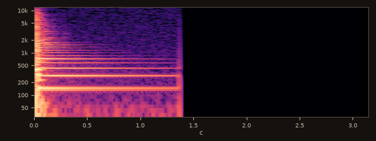
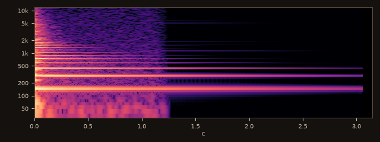

# Dombra Studio · Домбыра · Домбра

**Тегін виртуалды қазақ домбырасы** · **Бесплатная виртуальная казахская домбра** · **Free virtual Kazakh dombra**

DecentSampler · SFZ · MP3 note set · A = 440 Hz

[](#)
[](#)
[](LICENSE)
[](https://azamaperdeev05.github.io/dombra-studio/)

[Қазақша](#қазақша) · [Русский](#русский) · [English](#english)

| Бастапқы · Исходник · Original | Dombra Studio |
|---|---|
|  |  |
| Гуіл, кесілген соңы · Гул, обрезанный хвост · Rumble, cut-off tail | Таза, табиғи өшу · Чисто, естественное затухание · Clean, natural decay |

🎧 Тыңдау · Слушать · Listen: [demo_before.mp3](docs/audio/demo_before.mp3) → [demo_after.mp3](docs/audio/demo_after.mp3)
📊 Толық талдау · Полный анализ · Full analysis: **https://azamaperdeev05.github.io/dombra-studio/**

---

## Қазақша

### Бұл не?
Домбыраның 40 нақты жазбасынан (2 ішек × 20 перне) жасалған виртуалды аспап. Оны кез келген DAW-та (FL Studio, Ableton, Logic, Reaper) MIDI-клавиатурамен ойнауға немесе өз қосымшаңызда, сайтыңызда, ойыныңызда ноталар ойнатқыш ретінде қолдануға болады.

### Мүмкіндіктері
- **A = 440 Гц бойынша бапталған.** Бастапқы жазбалар 22–75 цент төмен болған. Әр нота жеке өлшеніп түзетілді, қатесі ≤ 2.2 цент.
- **Таза дыбыс.** Инфра-бас гуілі мен DC ығысуы жойылды. Шертпе бастапқыдағыдай ашық қалды, бұл тестпен тексеріледі.
- **Табиғи өшу.** Кесіліп қалған ноталардың соңы гармоникалар бойынша −70 дБ-ге дейін қалпына келтірілді.
- **Round-robin.** Әр нота 3 нұсқамен ойнайды, сондықтан қайталанған нота бірдей естілмейді.
- **Қағыс пресеті.** Екі ішек бірге шертіледі, төмен және жоғары қағыс кезектеседі.
- **Шанақты соғу** дыбысы бар (C2).
- **Диапазон:** A2–E5.

### Қалай қолдану керек
**DAW-та:** тегін [DecentSampler](https://www.decentsamples.com/product/decent-sampler-plugin/) плагинін орнатып, `Dombra.dspreset` немесе `Dombra-Qagys.dspreset` файлын ашыңыз. SFZ ойнатқыштарына (sforzando, sfizz) `Dombra.sfz` файлы арналған. `Samples/` папкасы пресеттің жанында тұруы керек.

**Қосымшада немесе сайтта:** `Notes-D-G/` папкасында `u0.mp3 … u19.mp3`, `d0.mp3 … d19.mp3` және `beat.mp3` файлдары бар.

| Папка | Бұрау | u0 | d0 | d19 |
|---|---|---|---|---|
| `Notes-D-G/` | Ре–Соль (дәстүрлі) | D3 | G3 | D5 |
| `Notes-C-F/` | Жазбаның өз биіктігі | C3 | F3 | C5 |

**Клавиатура:** C3–E3 тек үстіңгі ішек, F3–G4 екі ішек кезектеседі, G#4–C5 тек астыңғы ішек. C2 — шанақ соғу. Velocity тек қаттылықты басқарады.

### Жүктеп алу
Беттің жоғарғы жағындағы **Code → Download ZIP** батырмасын басыңыз немесе [Releases](../../releases) бөлімінен дайын архивтерді алыңыз.

### Шектеулері
Бастапқы жазбалар моно, 64 kbps AAC форматында, әр нотаға бір динамика. Сапаны одан әрі көтеру үшін домбыраны WAV форматында, әр нотаны бірнеше күшпен қайта жазу керек. Жоспар [талдау есебінде](https://azamaperdeev05.github.io/dombra-studio/#next) берілген.

---

## Русский

### Что это?
Виртуальный инструмент из 40 реальных записей казахской домбры (2 струны × 20 ладов). Играйте на MIDI-клавиатуре в любой DAW (FL Studio, Ableton, Logic, Reaper) или используйте как набор нот в своём приложении, на сайте, в игре.

### Возможности
- **Строй A = 440 Гц.** Исходные записи были занижены на 22–75 центов. Каждая нота измерена и исправлена, погрешность ≤ 2,2 цента.
- **Чистый звук.** Убраны инфранизкий гул и смещение DC. Атака щипка осталась такой же яркой, как в оригинале, это проверяется тестом.
- **Естественное затухание.** Обрезанные хвосты нот восстановлены по гармоникам до −70 дБ.
- **Round-robin.** У каждой ноты 3 варианта, повторы не звучат одинаково.
- **Пресет «Қағыс».** Бой по двум струнам, удары вниз и вверх чередуются.
- **Удар по корпусу** (C2).
- **Диапазон:** A2–E5.

### Как использовать
**В DAW:** установите бесплатный плагин [DecentSampler](https://www.decentsamples.com/product/decent-sampler-plugin/) и откройте `Dombra.dspreset` или `Dombra-Qagys.dspreset`. Для SFZ-плееров (sforzando, sfizz) предназначен `Dombra.sfz`. Папка `Samples/` должна лежать рядом с пресетом.

**В приложении или на сайте:** в папке `Notes-D-G/` лежат файлы `u0.mp3 … u19.mp3`, `d0.mp3 … d19.mp3` и `beat.mp3`.

| Папка | Строй | u0 | d0 | d19 |
|---|---|---|---|---|
| `Notes-D-G/` | Ре–Соль (традиционный) | D3 | G3 | D5 |
| `Notes-C-F/` | Высота самой записи | C3 | F3 | C5 |

**Клавиатура:** C3–E3 только верхняя струна, F3–G4 струны чередуются, G#4–C5 только нижняя струна. C2 — удар по корпусу. Velocity управляет только громкостью.

### Скачать
Нажмите **Code → Download ZIP** вверху страницы или возьмите готовые архивы в разделе [Releases](../../releases).

### Ограничения
Исходные записи моно, AAC 64 kbps, по одной динамике на ноту. Чтобы поднять качество дальше, нужна новая запись в WAV с несколькими силами щипка. План записи есть в [отчёте](https://azamaperdeev05.github.io/dombra-studio/#next).

---

## English

### What is it?
A virtual instrument built from 40 real recordings of a Kazakh dombra (2 strings × 20 frets). Play it from a MIDI keyboard in any DAW (FL Studio, Ableton, Logic, Reaper), or drop the note set into your own app, website or game.

### Features
- **Tuned to A = 440 Hz.** The source recordings were 22–75 cents flat. Every note was measured and corrected to within 2.2 cents.
- **Clean sound.** Infrasonic rumble and DC offset are removed. The pluck keeps its original brightness, and a test checks that on every build.
- **Natural decay.** Cut-off note tails are resynthesised from their harmonics down to −70 dB.
- **Round robin.** Every note has 3 variants, so repeated notes don't sound identical.
- **Qagys (strum) preset.** Both strings strummed together, alternating down and up strokes.
- **Body knock** on C2.
- **Range:** A2–E5.

### How to use
**In a DAW:** install the free [DecentSampler](https://www.decentsamples.com/product/decent-sampler-plugin/) plugin and open `Dombra.dspreset` or `Dombra-Qagys.dspreset`. For SFZ players (sforzando, sfizz), use `Dombra.sfz`. Keep the `Samples/` folder next to the preset.

**In an app or website:** `Notes-D-G/` holds `u0.mp3 … u19.mp3`, `d0.mp3 … d19.mp3` and `beat.mp3`.

| Folder | Tuning | u0 | d0 | d19 |
|---|---|---|---|---|
| `Notes-D-G/` | D–G (traditional) | D3 | G3 | D5 |
| `Notes-C-F/` | Recorded pitch | C3 | F3 | C5 |

**Keyboard:** C3–E3 upper string only, F3–G4 the strings alternate, G#4–C5 lower string only. C2 is the body knock. Velocity controls volume only.

### Download
Click **Code → Download ZIP** at the top of the page, or grab the ready-made archives from [Releases](../../releases).

### Limitations
The source recordings are mono, 64 kbps AAC, with one dynamic level per note. Going further needs a new WAV recording with several plucking strengths. A recording plan is in the [analysis report](https://azamaperdeev05.github.io/dombra-studio/#next).

---

## Build from source · Қайта құрастыру · Сборка

Needs Python 3, `numpy`, `scipy` and `ffmpeg`.

```bash
mkdir originals
for s in u d; do for i in $(seq 0 19); do
  curl -sL -o originals/$s$i.m4a https://raw.githubusercontent.com/metahdev/Dombra/HEAD/Dombra/Resources/Audio/Notes/$s$i.m4a
done; done
curl -sL -o originals/beat.mp3 https://raw.githubusercontent.com/metahdev/Dombra/HEAD/Dombra/Resources/Audio/beat.mp3
python3 build.py originals        # writes Dombra-Studio/
python3 test_build.py originals   # tuning, tail joins, pluck brightness, note sets
```

## Credits & license · Авторлар · Лицензия

- **Recordings:** the source samples come from [metahdev/Dombra](https://github.com/metahdev/Dombra). That repository states no license, so the rights to the recordings stay with their author. The files here are processed versions of them. If you are the author and want changes, please open an issue.
- **Code** (`build.py`, `test_build.py`, presets, report page): [MIT](LICENSE).
- **Research and further reading:** see the sources section of the [analysis report](https://azamaperdeev05.github.io/dombra-studio/#sources).

<sub>Keywords: dombra, dombyra, dumbyra, домбыра, домбра, Kazakh dombra samples, free dombra VST, DecentSampler dombra, SFZ dombra, қазақ музыкалық аспабы, казахский народный инструмент, sample library, virtual instrument.</sub>
